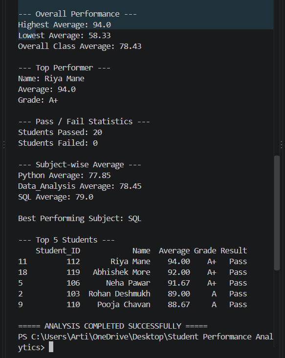

# Student Performance Analytics System

## 1. Project Title

### Student Performance Analytics System

Technology Used: Python, NumPy, Pandas

Project Type: Python Data Analysis Project

---

## 2. Objective

The main objective of this project is to build a Python-based Student Performance Analytics System that reads, processes and analyzes student data.

The system analyzes student marks and attendance and produces meaningful results such as total marks, average marks, grades, pass/fail status, subject-wise performance and top-performing students.

---

## 3. Technologies Used

The following technologies and tools were used:

- Python 3.14.8
- NumPy
- Pandas
- CSV
- Visual Studio Code

NumPy was used for numerical calculations and Pandas was used for loading, processing and analyzing the student dataset.

---

## 4. Dataset Description

The project uses a CSV file named `students.csv`.

The dataset contains 20 student records.

The dataset includes the following fields:

- Student ID
- Name
- Department
- Python Marks
- Data Analysis Marks
- SQL Marks
- Attendance

The dataset contains marks for three subjects: Python, Data Analysis and SQL.

---

## 5. Implementation

The project was implemented using Python, NumPy and Pandas.

### Step 1: Reading the Dataset

The student data is loaded from the CSV file using Pandas.

### Step 2: Processing the Data

The system calculates total marks and average marks for each student.

### Step 3: Grade Calculation

Grades are assigned according to the average marks.

The grading rule used is:

- 90 and above: A+
- 80–89: A
- 70–79: B
- 60–69: C
- 50–59: D
- Below 50: F

### Step 4: Pass/Fail Analysis

A student is considered passed when all subject marks are at least 40 and attendance is at least 75%.

### Step 5: Performance Analysis

The system calculates:

- Highest average
- Lowest average
- Overall class average
- Subject-wise averages
- Top-performing students

### Step 6: Top Performers

The students are sorted according to their average marks and the top 5 students are displayed.

---

## 6. Key Features

The main features of the project are:

1. Loading student data using Pandas.
2. Organizing data using a DataFrame.
3. Calculating total marks.
4. Calculating average marks.
5. Assigning grades.
6. Identifying pass/fail students.
7. Finding highest and lowest performance.
8. Calculating overall class average.
9. Performing subject-wise analysis.
10. Identifying top 5 students.
11. Using reusable functions.
12. Using loops and conditions.
13. Using NumPy for numerical calculations.

---

## 7. Output / Screenshots

The project was successfully executed in Visual Studio Code.

The system produced the following results:

- Total Students: 20
- Students Passed: 20
- Students Failed: 0
- Overall Class Average: 78.43
- Highest Average: 94.00
- Lowest Average: 58.33
- Best Performing Subject: SQL
- Top Performer: Riya Mane
- Top Performer Average: 94.00
- Top Performer Grade: A+

---

## 8. Final Outcome

The Student Performance Analytics System was successfully developed and tested.

The system reads student data from a CSV file and performs different types of academic analysis.

It successfully calculates marks, averages, grades, pass/fail status and subject-wise performance and identifies the top-performing students.

---

## 9. Challenges & Learning

### Challenges

During the development of the project, Python and the required libraries had to be installed and configured in Visual Studio Code.

### Learning

Through this project, the following concepts were practiced:

- Python programming
- Variables and data handling
- Conditions
- Loops
- Functions
- NumPy
- Pandas
- DataFrame operations
- CSV data handling
- Basic data analysis
- Running Python programs in Visual Studio Code

The project also provided practical experience in organizing and testing a Python data-analysis project.

---

## 10. GitHub Repository

The GitHub repository link will be added after uploading the completed project to GitHub.

GitHub Repository:

To be added after GitHub submission.

---

## Conclusion

The Student Performance Analytics System successfully analyzes student academic data using Python, NumPy and Pandas.

The project fulfills the main requirements of the assignment by performing student performance calculations, grade assignment, pass/fail analysis, subject-wise analysis and identification of top-performing students.